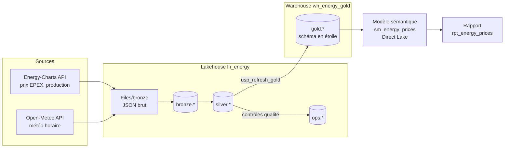
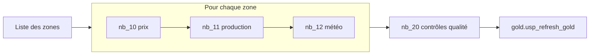

# Prix day-ahead de l'électricité en Europe — Microsoft Fabric

Plateforme de données de bout en bout sur Microsoft Fabric : ingestion des prix day-ahead EPEX Spot de cinq zones de marché européennes (France, Belgique, Allemagne-Luxembourg, Pays-Bas, Espagne), de la production électrique par filière et de la météo, modélisation en étoile dans un Warehouse, modèle sémantique Direct Lake et rapport Power BI.

Le rapport répond à quatre questions :

1. Comment les prix évoluent-ils d'un pays à l'autre, et combien d'heures sont à prix négatif ?
2. Pour une zone et un jour donnés, à quelle heure vaut-il mieux consommer ?
3. Combien rapporterait une batterie domestique chargée aux heures creuses et déchargée aux heures de pointe ?
4. Dans quelle mesure le vent, le soleil et la demande expliquent-ils le prix ?

## Architecture



| Couche | Stockage | Contenu | Écriture |
|---|---|---|---|
| Landing | `lh_energy` / `Files/bronze` | réponses JSON des API, inchangées | un fichier par appel |
| Bronze | `lh_energy.bronze` | lignes brutes + lignage (`source_file`, `pipeline_run_id`) | ajout seul |
| Silver | `lh_energy.silver` | données typées, dédoublonnées, heure locale, référentiels | `MERGE` idempotent |
| Gold | `wh_energy_gold.gold` | faits et dimensions pour l'analyse | procédure T-SQL, fenêtre glissante |
| Ops | `lh_energy.ops` | journal d'ingestion, résultats qualité | ajout seul |

## Stack

Microsoft Fabric (Lakehouse, Warehouse, Data Pipeline, Environment, Git integration), PySpark, Delta Lake, T-SQL, DAX, Power BI (Direct Lake, format PBIR), Python (bibliothèque interne packagée en wheel), pytest, GitHub Actions.

## Organisation du dépôt

```
fabric/                       éléments Fabric synchronisés par l'intégration Git
  00_Config/                  environnement Spark (bibliothèques, configuration)
  01_Storage/                 lakehouse lh_energy, warehouse wh_energy_gold (projet SQL)
  02_Notebooks/               ingestion, référentiels, qualité, maintenance
  03_Orchestration/           pipeline pl_energy_daily et sa planification
  04_Reporting/               modèle sémantique (TMDL) et rapport (PBIR)
src/energy_toolkit/           code partagé par les notebooks (clients API, dates, helpers Delta)
tests/                        tests unitaires de energy_toolkit
docs/                         modèle de données, exploitation
```

## Pipeline quotidien

`pl_energy_daily` s'exécute toutes les trois heures.



| Étape | Élément | Rôle |
|---|---|---|
| 1 | `nb_10_ingest_day_ahead_prices` | prix au quart d'heure (au pas horaire avant le 1er octobre 2025) |
| 2 | `nb_11_ingest_power_generation` | production nette par filière et consommation |
| 3 | `nb_12_ingest_weather` | rayonnement, vent à 100 m, température, nébulosité (observé et prévu) |
| 4 | `nb_20_data_quality` | complétude, bornes de marché, publication de J+1 ; bloque la suite en cas d'erreur |
| 5 | `gold.usp_refresh_gold` | reconstruction des faits gold sur la fenêtre glissante, en transaction |

Paramètres du pipeline : `p_zone_codes`, `p_start_date`, `p_end_date` (rechargement d'une période), `p_lookback_days`, `p_full_reload`.

## Modèle de données

Schéma en étoile dans `wh_energy_gold`, exposé en Direct Lake. Détail des tables, grains et mesures : [docs/data-model.md](docs/data-model.md).

| Table | Grain |
|---|---|
| `fact_price_interval` | zone × intervalle de livraison (15 min) |
| `fact_daily_price` | zone × jour |
| `fact_hourly_energy` | zone × heure : prix, production, météo |
| `fact_daily_battery` | zone × jour × scénario de batterie |
| `dim_bidding_zone`, `dim_date`, `dim_time_of_day`, `battery_scenario` | dimensions |

## Qualité des données

Les contrôles de `nb_20_data_quality` sont historisés dans `ops.data_quality_result`.

| Contrôle | Sévérité |
|---|---|
| Nombre d'intervalles reçus par jour égal au nombre attendu (jours de 23 h et 25 h compris) | ERROR |
| Prix compris entre -500 et 4 000 €/MWh (bornes SDAC) | ERROR |
| Prix de J+1 présents après 14h00 | WARNING |
| Aucune valeur météo manquante | WARNING |

Une erreur arrête le pipeline avant la couche gold : le rapport continue d'afficher les dernières données validées.

## Choix techniques

- Idempotence : chaque ingestion fait un `MERGE` sur la clé métier et ne réécrit une ligne que si une valeur a changé. Un même créneau peut être rechargé sans créer de doublon.
- Rejeu sans appel API : les réponses brutes sont conservées dans `Files/bronze`.
- Pas de 15 minutes : la résolution est déduite des données, ce qui couvre la période avant et après le passage d'EPEX au quart d'heure.
- Heure locale : les dates de livraison sont calculées dans le fuseau de chaque marché, changements d'heure compris.
- Code partagé versionné : les clients API et les helpers Delta sont dans `energy_toolkit`, testé et packagé en wheel puis attaché à l'environnement Spark, plutôt que copiés d'un notebook à l'autre.
- Synchronisation du SQL endpoint : le pipeline force la synchronisation des métadonnées du lakehouse avant la procédure gold, qui lit le silver par requête inter-bases.
- Rapport versionné : le rapport est au format PBIR et le modèle au format TMDL : chaque modification est lisible dans l'historique Git.

## Déploiement

1. Créer un espace de travail Fabric et le connecter à ce dépôt (branche `main`, dossier `fabric`) depuis *Paramètres de l'espace → Intégration Git*.
2. Exécuter `nb_00_setup_lakehouse` puis `nb_01_load_reference_data`.
3. Renseigner les tables de paramètres du warehouse : `gold.dim_time_of_day` (96 quarts d'heure, période de pointe 8h-20h) et `gold.battery_scenario` (capacité, puissance et rendement de chaque scénario).
4. Lancer `pl_energy_daily` avec `p_start_date` et `p_end_date` pour charger l'historique, puis `p_full_reload = true` pour reconstruire la couche gold.
5. Actualiser le modèle sémantique `sm_energy_prices`.

Exploitation courante, rechargement et incidents : [docs/runbook.md](docs/runbook.md).

Pour modifier `energy_toolkit` : `pip install -e ".[dev]"`, `pytest`, `python -m build --wheel`, puis publier le wheel dans l'environnement `env_energy_spark`.

## Sources et licences

- Prix day-ahead EPEX Spot et production électrique : [Energy-Charts](https://api.energy-charts.info), Fraunhofer ISE, licence CC BY 4.0.
- Météo : [Open-Meteo](https://open-meteo.com), licence CC BY 4.0.

Les prix affichés sont des prix de gros, hors taxes et coûts d'acheminement. La simulation de batterie donne un ordre de grandeur, pas une estimation de revenu pour un particulier.

## Auteur

Gane Kwada Amala, Data Engineer.
