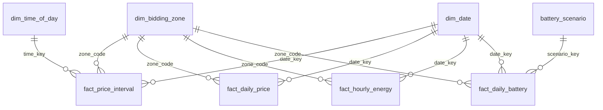

# Modèle de données

## Couche silver (`lh_energy.silver`)

| Table | Clé | Source | Remarques |
|---|---|---|---|
| `day_ahead_price` | `zone_code`, `interval_start_utc` | Energy-Charts `/price` | `resolution_minutes` 15 ou 60, `delivery_date_local` dans le fuseau du marché, `price_ct_kwh` = €/MWh ÷ 10 |
| `power_generation` | `country_code`, `interval_start_utc`, `production_type` | Energy-Charts `/public_power` | format long, `production_category` et `value_unit` (MW ou %) |
| `weather_hourly` | `zone_code`, `interval_start_utc` | Open-Meteo | `is_forecast` passe à `false` quand l'observation remplace la prévision |
| `dim_bidding_zone` | `zone_code` | `energy_toolkit.reference` | fuseau du marché, point de référence météo |
| `dim_date` | `calendar_date` | généré | jours ISO, `year_month` |
| `public_holiday` | `calendar_date`, `country_iso2` | bibliothèque `holidays` | |

## Couche gold (`wh_energy_gold.gold`)

Alimentée par `gold.usp_refresh_gold`. Les dimensions sont rechargées entièrement ; les faits sont supprimés puis réinsérés sur la fenêtre `@lookback_days`, ou sur tout l'historique avec `@full_reload = 1`. Chaque bloc s'exécute dans une transaction.

| Table | Grain | Contenu |
|---|---|---|
| `fact_price_interval` | zone × intervalle | prix, rang du prix dans la journée, conseil de consommation |
| `fact_daily_price` | zone × jour | moyenne, min, max, écart-type, pointe / hors pointe, intervalles négatifs, jour férié |
| `fact_hourly_energy` | zone × heure | prix horaire moyen, solaire, éolien terrestre et en mer, nucléaire, gaz, consommation, part renouvelable, météo |
| `fact_daily_battery` | zone × jour × scénario | prix moyen de charge et de décharge, énergie, coût, valeur, gain |
| `dim_time_of_day` | quart d'heure | libellés `HH:MM`, heure, période de la journée, pointe 8h-20h |
| `battery_scenario` | scénario | capacité (kWh), puissance (kW), rendement aller-retour |

### Conseil de consommation

Calculé par jour et par zone à partir du rang du prix de chaque intervalle :

| Conseil | Règle |
|---|---|
| 1-Charger + consommer | prix négatif |
| 2-Charger la batterie | 25 % des intervalles les moins chers |
| 3-Consommer sur le réseau | jusqu'à 60 % |
| 4-Utiliser la batterie | jusqu'à 85 % |
| 5-Batterie + revente | 15 % les plus chers |

### Simulation de batterie

Un cycle par jour. Pour un scénario de capacité C et de puissance P, la batterie se charge pendant les N = ⌈C / P⌉ heures les moins chères et se décharge pendant les N heures les plus chères. Gain = C × (rendement × prix moyen de décharge − prix moyen de charge), ramené à zéro s'il est négatif.

## Modèle sémantique (`sm_energy_prices`)

Direct Lake sur le warehouse, culture `fr-FR`. Les mesures sont rangées par dossier d'affichage.

| Dossier | Mesures |
|---|---|
| 1. Prix | prix moyen, médian, min, max, amplitude, pointe, hors pointe, prime de pointe, J-1, heures à prix négatif (total et par zone), volatilité |
| 2. Conseil | créneau le moins cher, créneau le plus cher (une zone et un jour sélectionnés) |
| 3. Production & météo | solaire, éolien, consommation, part renouvelable, température, vent |
| 4. Analyse | corrélations de Pearson du prix horaire avec le vent, l'ensoleillement et la part renouvelable |
| 5. Batterie | gain d'arbitrage, gain moyen par jour, gain annualisé, écart charge / décharge (par batterie) |
| 9. Technique | date et heure du dernier prix disponible |
